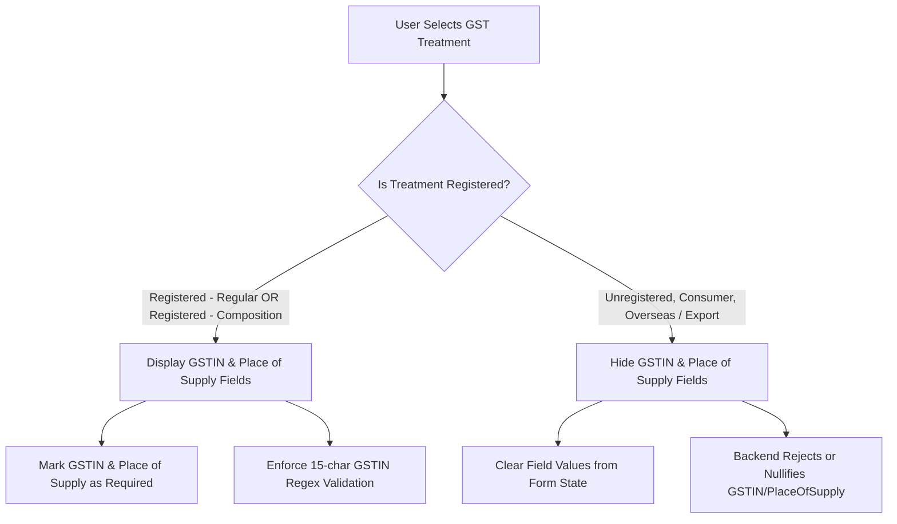
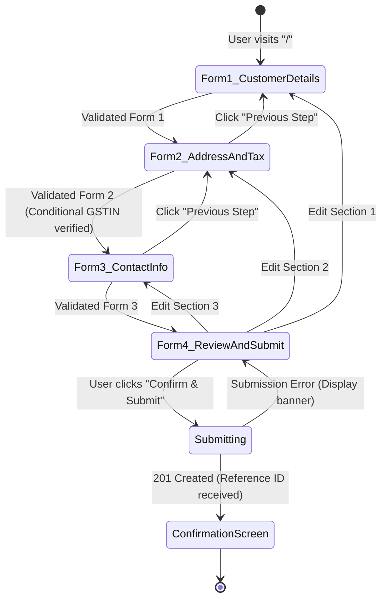

# Client Onboarding Management System - Technical Specification (SPEC.md)
**Document Version:** 1.0.0  
**Methodology:** Spec-Driven Development (SDD)  
**Status:** Approved Specification  
**Architecture:** MERN Stack (React 19 + Plain CSS + Express.js + MongoDB)

---

## 1. System Overview & Architectural Guardrails

### 1.1 Purpose
This document provides the canonical technical specification for the **Client Onboarding Management System**. In accordance with Spec-Driven Development (SDD), all development, validation logic, API contracts, UI component hierarchy, and database schemas must strictly adhere to the requirements detailed herein.

### 1.2 Core Architectural Principles
1. **Two Independent Portals:**
   - **Public Onboarding Portal (Unauthenticated):** Sequential 3-form stepper + review & confirmation flow for prospective clients.
   - **Internal Management Dashboard (Authenticated):** Secure administrative interface for internal staff to inspect, filter, search, and update client onboarding submissions.
2. **Plain CSS Only (Strict Prohibition):**
   - **NO Tailwind CSS, styled-components, or utility CSS libraries are permitted.**
   - Modular Plain CSS architecture utilizing CSS custom properties (design tokens) centralized in `variables.css`.
   - Component-scoped CSS files colocated with React components (`Component.jsx` + `Component.css`).
3. **Dual-Layer Mirror Validation:**
   - Client-side validation: React Hook Form + Zod resolver (`@hookform/resolvers/zod`).
   - Server-side validation: Express request middleware using identical Zod schemas.
4. **Zero-Trust Backend Security:**
   - Helmet security headers, strict CORS configuration with credentials, IP rate limiting (`express-rate-limit`), and HTTP-only, secure, SameSite cookies for administrative JWT tokens.

---

## 2. User Roles & Access Control Matrix

| Role | Auth Mechanism | Accessible Routes & Capabilities |
| :--- | :--- | :--- |
| **Public Client** | None (Public) | - View & submit 3-step onboarding form (`/`)<br>- View review step and confirmation screen with Reference ID (`/confirmation/:referenceId`)<br>- Cannot view any other client's data or administrative routes |
| **Internal Staff / Admin** | JWT in HTTP-only Cookie (`SameSite=Strict`) | - Access login screen (`/admin/login`)<br>- Access admin dashboard (`/admin/dashboard`)<br>- Search, filter, and paginate submissions<br>- View complete submission details<br>- Mutate submission review status (`PATCH /api/onboarding/:id/status`) |

---

## 3. Data Dictionary & MongoDB Schema Specifications

### 3.1 Database: `client_onboarding`

#### 3.1.1 Collection: `onboardings`
```javascript
import mongoose from 'mongoose';

const addressSchema = new mongoose.Schema({
  line1: { type: String, required: true, trim: true },
  city: { type: String, required: true, trim: true },
  state: { type: String, required: true, trim: true },
  postalCode: { type: String, required: true, trim: true },
  country: { type: String, required: true, trim: true, default: 'India' }
}, { _id: false });

const customerDetailsSchema = new mongoose.Schema({
  customerType: { 
    type: String, 
    required: true, 
    enum: ['Business', 'Individual'] 
  },
  businessLegalName: { 
    type: String, 
    required: true, 
    trim: true,
    minlength: 2,
    maxlength: 200 
  },
  pan: { 
    type: String, 
    required: true, 
    uppercase: true, 
    trim: true,
    match: /^[A-Z]{5}[0-9]{4}[A-Z]{1}$/ 
  }
}, { _id: false });

const taxAndAddressDetailsSchema = new mongoose.Schema({
  address: { type: addressSchema, required: true },
  currency: { 
    type: String, 
    required: true, 
    enum: ['INR', 'USD', 'EUR', 'AED', 'GBP', 'SGD', 'CAD', 'AUD'] 
  },
  gstTreatment: { 
    type: String, 
    required: true, 
    enum: [
      'Registered - Regular', 
      'Registered - Composition', 
      'Unregistered', 
      'Consumer', 
      'Overseas / Export'
    ] 
  },
  gstin: { 
    type: String, 
    trim: true, 
    uppercase: true,
    default: null,
    match: [/^[0-9]{2}[A-Z]{5}[0-9]{4}[A-Z]{1}[1-9A-Z]{1}Z[0-9A-Z]{1}$/, 'Invalid GSTIN format']
  },
  placeOfSupply: { 
    type: String, 
    trim: true,
    default: null 
  }
}, { _id: false });

const contactDetailsSchema = new mongoose.Schema({
  customerLanguage: { 
    type: String, 
    required: true, 
    enum: ['English', 'Malayalam', 'Hindi', 'Tamil', 'Kannada', 'Telugu', 'Arabic', 'Spanish', 'French'] 
  },
  contactPerson: { 
    type: String, 
    required: true, 
    trim: true,
    minlength: 2,
    maxlength: 100 
  },
  email: { 
    type: String, 
    required: true, 
    lowercase: true, 
    trim: true,
    match: /^[^\s@]+@[^\s@]+\.[^\s@]+$/ 
  },
  phone: { 
    type: String, 
    required: true, 
    trim: true 
  },
  alternatePhone: { 
    type: String, 
    trim: true,
    default: null 
  }
}, { _id: false });

const onboardingSubmissionSchema = new mongoose.Schema({
  referenceId: { 
    type: String, 
    required: true, 
    unique: true, 
    index: true 
  },
  customerDetails: { type: customerDetailsSchema, required: true },
  taxAndAddressDetails: { type: taxAndAddressDetailsSchema, required: true },
  contactDetails: { type: contactDetailsSchema, required: true },
  status: { 
    type: String, 
    enum: ['new', 'under_review', 'approved', 'rejected'], 
    default: 'new',
    index: true 
  },
  submittedAt: { 
    type: Date, 
    default: Date.now,
    index: true 
  },
  reviewedBy: { 
    type: mongoose.Schema.Types.ObjectId, 
    ref: 'StaffUser', 
    default: null 
  },
  reviewNotes: { 
    type: String, 
    default: null 
  }
}, { timestamps: true });

export const Onboarding = mongoose.model('Onboarding', onboardingSubmissionSchema);
```

#### 3.1.2 Collection: `staff_users`
```javascript
const staffUserSchema = new mongoose.Schema({
  email: { type: String, required: true, unique: true, lowercase: true, trim: true },
  password: { type: String, required: true }, // bcrypt hashed (salt rounds: 12)
  fullName: { type: String, required: true, trim: true },
  role: { type: String, enum: ['admin', 'staff'], default: 'staff' },
  isActive: { type: Boolean, default: true }
}, { timestamps: true });

export const StaffUser = mongoose.model('StaffUser', staffUserSchema);
```

---

## 4. Reference ID Generation Specification

### 4.1 Format Specification
`CL-YYYY-XXXX`
- `CL-`: System prefix denoting Client Onboarding.
- `YYYY`: 4-digit current year (e.g. `2026`).
- `XXXX`: Zero-padded 4-digit incremental or randomized collision-resistant counter (e.g. `0001`, `0042`).
- Example: `CL-2026-0001`.

---

## 5. Form Field Specifications & Conditional Logic

### 5.1 Form 1: Customer & Legal Details
| Field Name | Component Type | Options / Constraints | Required | Validation Rule |
| :--- | :--- | :--- | :--- | :--- |
| `customerType` | Select Dropdown | `Business`, `Individual` | Yes | Must be one of enum values |
| `businessLegalName` | Text Input | Placeholder: "Acme Technologies Private Limited" | Yes | String, 2-200 chars, trimmed |
| `pan` | Text Input | Placeholder: "ABCDE1234F" | Yes | Regex: `^[A-Z]{5}[0-9]{4}[A-Z]{1}$` |

### 5.2 Form 2: Address & Tax Specifics
| Field Name | Component Type | Options / Constraints | Required | Validation Rule |
| :--- | :--- | :--- | :--- | :--- |
| `address.line1` | Text Input | Street Address / Building / Unit | Yes | String, 3-255 chars |
| `address.city` | Text Input | City / District | Yes | String, 2-100 chars |
| `address.state` | Text Input / Select | State / Province | Yes | String, 2-100 chars |
| `address.postalCode` | Text Input | Postal / PIN / ZIP code | Yes | Regex / alphanumeric string (3-12 chars) |
| `address.country` | Select / Text | Country (Default: India) | Yes | String, non-empty |
| `currency` | Select Dropdown | `INR`, `USD`, `EUR`, `AED`, `GBP`, `SGD`, `CAD`, `AUD` | Yes | Must be one of enum values |
| `gstTreatment` | Select Dropdown | 1. `Registered - Regular`<br>2. `Registered - Composition`<br>3. `Unregistered`<br>4. `Consumer`<br>5. `Overseas / Export` | Yes | Must be one of enum values |
| `gstin` | Text Input | 15-character GSTIN format | **Conditional** | **Required if registered**; Must match regex: `^[0-9]{2}[A-Z]{5}[0-9]{4}[A-Z]{1}[1-9A-Z]{1}Z[0-9A-Z]{1}$`. Must be empty/null otherwise. |
| `placeOfSupply` | Select / Text | State code or State name | **Conditional** | **Required if registered**; Must be empty/null otherwise. |

#### 5.2.1 Conditional Logic Specification: GST Treatment Matrix


### 5.3 Form 3: Communication & Contact Info
| Field Name | Component Type | Options / Constraints | Required | Validation Rule |
| :--- | :--- | :--- | :--- | :--- |
| `customerLanguage` | Select Dropdown | `English`, `Malayalam`, `Hindi`, `Tamil`, `Kannada`, `Telugu`, `Arabic`, `Spanish`, `French` | Yes | Must be one of enum values |
| `contactPerson` | Text Input | Full name of primary contact person | Yes | String, 2-100 chars |
| `email` | Email Input | Primary official communication email | Yes | Standard email format (`z.string().email()`) |
| `phone` | Tel Input | Primary phone with country code | Yes | Regex: `^\+?[1-9]\d{6,14}$` |
| `alternatePhone` | Tel Input | Optional backup phone number | No | Optional. If provided, regex: `^\+?[1-9]\d{6,14}$` |

### 5.4 Form 4: Review & Submit
- Visual breakdown cards for:
  1. Customer & Legal Details (with "Edit Section 1" action button).
  2. Address & Tax Information (with "Edit Section 2" action button).
  3. Contact & Communication Details (with "Edit Section 3" action button).
- Declaration checkbox: "I verify that the above information is accurate and legally valid."
- Action buttons: "Back to Step 3", "Submit Onboarding Application".

### 5.5 Confirmation Screen
- Success indicator icon (green checkmark).
- Prominent Reference ID display (with 1-click Copy to Clipboard button).
- Submission status pill: `new` ("Submitted - Under Review").
- Instruction summary on next steps (review SLA, email notification notice).
- Action button: "Submit Another Onboarding".

---

## 6. Shared Validation Schemas (Zod)

```javascript
import { z } from 'zod';

export const panRegex = /^[A-Z]{5}[0-9]{4}[A-Z]{1}$/;
export const gstinRegex = /^[0-9]{2}[A-Z]{5}[0-9]{4}[A-Z]{1}[1-9A-Z]{1}Z[0-9A-Z]{1}$/;
export const phoneRegex = /^\+?[1-9]\d{6,14}$/;

export const form1CustomerDetailsSchema = z.object({
  customerType: z.enum(['Business', 'Individual'], {
    required_error: 'Please select a customer type'
  }),
  businessLegalName: z.string().trim().min(2, 'Legal name must be at least 2 characters').max(200),
  pan: z.string().trim().toUpperCase().regex(panRegex, 'Invalid PAN format. Must be 5 letters, 4 numbers, 1 letter (e.g. ABCDE1234F)')
});

export const form2TaxAndAddressSchema = z.object({
  address: z.object({
    line1: z.string().trim().min(3, 'Address line 1 is required'),
    city: z.string().trim().min(2, 'City is required'),
    state: z.string().trim().min(2, 'State is required'),
    postalCode: z.string().trim().min(3, 'Postal code is required').max(12),
    country: z.string().trim().min(2, 'Country is required').default('India')
  }),
  currency: z.enum(['INR', 'USD', 'EUR', 'AED', 'GBP', 'SGD', 'CAD', 'AUD'], {
    required_error: 'Please select a currency'
  }),
  gstTreatment: z.enum([
    'Registered - Regular', 
    'Registered - Composition', 
    'Unregistered', 
    'Consumer', 
    'Overseas / Export'
  ], {
    required_error: 'Please select GST treatment'
  }),
  gstin: z.string().trim().toUpperCase().optional().nullable(),
  placeOfSupply: z.string().trim().optional().nullable()
}).superRefine((data, ctx) => {
  const isRegistered = 
    data.gstTreatment === 'Registered - Regular' || 
    data.gstTreatment === 'Registered - Composition';

  if (isRegistered) {
    if (!data.gstin || !gstinRegex.test(data.gstin)) {
      ctx.addIssue({
        code: z.ZodIssueCode.custom,
        path: ['gstin'],
        message: 'Valid 15-character GSTIN is required for registered tax treatment'
      });
    }
    if (!data.placeOfSupply || data.placeOfSupply.trim().length === 0) {
      ctx.addIssue({
        code: z.ZodIssueCode.custom,
        path: ['placeOfSupply'],
        message: 'Place of supply is required when GST applies'
      });
    }
  }
});

export const form3ContactDetailsSchema = z.object({
  customerLanguage: z.enum([
    'English', 'Malayalam', 'Hindi', 'Tamil', 'Kannada', 'Telugu', 'Arabic', 'Spanish', 'French'
  ], {
    required_error: 'Please select preferred communication language'
  }),
  contactPerson: z.string().trim().min(2, 'Contact person name is required').max(100),
  email: z.string().trim().email('Valid email address is required'),
  phone: z.string().trim().regex(phoneRegex, 'Valid phone number with country code is required'),
  alternatePhone: z.string().trim().regex(phoneRegex, 'Invalid alternate phone number').optional().or(z.literal('')).nullable()
});

export const completeOnboardingSubmissionSchema = z.object({
  customerDetails: form1CustomerDetailsSchema,
  taxAndAddressDetails: form2TaxAndAddressSchema,
  contactDetails: form3ContactDetailsSchema
});
```

---

## 7. Backend API Contract Specifications

### 7.1 Public Endpoints (No Auth Required)

#### `POST /api/public/onboarding`
- **Purpose:** Submits complete onboarding data, validates schema, persists to MongoDB, and returns generated Reference ID.
- **Rate Limit:** 10 requests per 15 minutes per IP.
- **Request Headers:** `Content-Type: application/json`
- **Request Body:** JSON matching `completeOnboardingSubmissionSchema`.
- **Response `201 Created`:**
  ```json
  {
    "success": true,
    "message": "Onboarding application submitted successfully",
    "data": {
      "referenceId": "CL-2026-0001",
      "status": "new",
      "submittedAt": "2026-11-09T08:30:00.000Z"
    }
  }
  ```
- **Error Responses:**
  - `400 Bad Request`: Zod validation errors formatted with field paths and messages.
  - `429 Too Many Requests`: Rate limit exceeded message.
  - `500 Internal Server Error`: Standardized server error response.

---

### 7.2 Administrative Endpoints (Staff Auth Required)

#### `POST /api/auth/login`
- **Purpose:** Authenticates staff member credentials and sets an HTTP-only JWT cookie.
- **Rate Limit:** 5 requests per 15 minutes per IP.
- **Request Body:**
  ```json
  { "email": "admin@company.com", "password": "securePassword123!" }
  ```
- **Response Headers:** `Set-Cookie: token=<jwt>; HttpOnly; Secure; SameSite=Strict; Path=/; Max-Age=86400`
- **Response `200 OK`:**
  ```json
  {
    "success": true,
    "user": {
      "id": "6730a8...",
      "email": "admin@company.com",
      "fullName": "Admin User",
      "role": "admin"
    }
  }
  ```

#### `POST /api/auth/logout`
- **Purpose:** Clears JWT cookie.
- **Response Headers:** `Set-Cookie: token=; Path=/; Expires=Thu, 01 Jan 1970 00:00:00 GMT`

#### `GET /api/auth/me`
- **Purpose:** Validates active session from cookie and returns current user details.

#### `GET /api/onboarding`
- **Purpose:** Paginated list of onboarding submissions with search & status filter.
- **Query Parameters:**
  - `page`: integer (default: `1`)
  - `limit`: integer (default: `10`, max: `50`)
  - `status`: string (`all` | `new` | `under_review` | `approved` | `rejected`)
  - `search`: string (matches `referenceId`, `customerDetails.businessLegalName`, `customerDetails.pan`, `contactDetails.contactPerson`, `contactDetails.email`)
  - `sortBy`: string (`submittedAt` | `businessLegalName`, default: `submittedAt`)
  - `order`: string (`asc` | `desc`, default: `desc`)
- **Response `200 OK`:**
  ```json
  {
    "success": true,
    "data": {
      "submissions": [...],
      "pagination": {
        "total": 45,
        "page": 1,
        "limit": 10,
        "totalPages": 5
      },
      "counts": {
        "total": 45,
        "new": 12,
        "under_review": 15,
        "approved": 16,
        "rejected": 2
      }
    }
  }
  ```

#### `GET /api/onboarding/:id`
- **Purpose:** Retrieve full details of a specific onboarding record by MongoDB ObjectId or Reference ID.

#### `PATCH /api/onboarding/:id/status`
- **Purpose:** Update status and add optional review notes.
- **Request Body:**
  ```json
  {
    "status": "approved",
    "reviewNotes": "All documents verified and PAN/GSTIN validated."
  }
  ```
- **Response `200 OK`:** Updated onboarding record.

---

## 8. Plain CSS Architecture & Design Token Specification

### 8.1 Design Tokens (`src/styles/variables.css`)
```css
:root {
  /* Brand & Accent Palette */
  --color-primary: #1e40af;
  --color-primary-hover: #1d4ed8;
  --color-primary-active: #172554;
  --color-primary-light: #eff6ff;

  /* Neutral Surface & Backgrounds */
  --color-bg-main: #f8fafc;
  --color-bg-card: #ffffff;
  --color-bg-subtle: #f1f5f9;
  
  /* Text & Typography */
  --color-text-primary: #0f172a;
  --color-text-secondary: #475569;
  --color-text-muted: #94a3b8;
  --color-text-inverse: #ffffff;

  /* Status Colors */
  --color-status-new: #0284c7;
  --color-status-new-bg: #e0f2fe;
  --color-status-review: #d97706;
  --color-status-review-bg: #fef3c7;
  --color-status-approved: #16a34a;
  --color-status-approved-bg: #dcfce7;
  --color-status-rejected: #dc2626;
  --color-status-rejected-bg: #fee2e2;

  /* Borders & Dividers */
  --color-border: #e2e8f0;
  --color-border-hover: #cbd5e1;
  --color-border-focus: #3b82f6;

  /* Typography Font Stacks */
  --font-family-base: -apple-system, BlinkMacSystemFont, "Segoe UI", Roboto, Helvetica, Arial, sans-serif;
  --font-family-mono: ui-monospace, SFMono-Regular, Menlo, Monaco, Consolas, monospace;

  /* Spacing Scale */
  --space-1: 0.25rem;   /* 4px */
  --space-2: 0.5rem;    /* 8px */
  --space-3: 0.75rem;   /* 12px */
  --space-4: 1rem;      /* 16px */
  --space-5: 1.25rem;   /* 20px */
  --space-6: 1.5rem;    /* 24px */
  --space-8: 2rem;      /* 32px */
  --space-10: 2.5rem;   /* 40px */
  --space-12: 3rem;     /* 48px */

  /* Border Radii */
  --radius-sm: 4px;
  --radius-md: 8px;
  --radius-lg: 12px;
  --radius-full: 9999px;

  /* Elevation Shadows */
  --shadow-sm: 0 1px 2px 0 rgba(0, 0, 0, 0.05);
  --shadow-md: 0 4px 6px -1px rgba(0, 0, 0, 0.1), 0 2px 4px -2px rgba(0, 0, 0, 0.1);
  --shadow-lg: 0 10px 15px -3px rgba(0, 0, 0, 0.1), 0 4px 6px -4px rgba(0, 0, 0, 0.1);

  /* Transitions */
  --transition-fast: 150ms ease-in-out;
  --transition-normal: 250ms ease-in-out;
}
```

### 8.2 Responsive Breakpoints (`src/styles/responsive.css`)
- **Mobile First:** Base CSS targets `< 640px` (single column forms, full-width buttons).
- **Tablet (`@media (min-width: 640px)`):** 2-column form grids for address lines, phone fields.
- **Desktop (`@media (min-width: 1024px)`):** Multi-column dashboard layouts, stepper lateral alignment.

---

## 9. State Management & Navigation Flow

### 9.1 Multi-Step Form State Machine


---

## 10. Acceptance & Verification Test Criteria

### 10.1 Form 1 Acceptance Criteria
- [ ] Submitting empty fields triggers localized inline Zod validation errors.
- [ ] Entering invalid PAN (e.g. `12345ABCDE` or `ABCDE12345`) displays format error.
- [ ] Valid PAN (e.g. `ABCDE1234F`) automatically transforms to uppercase and passes validation.

### 10.2 Form 2 Acceptance Criteria (Conditional GSTIN)
- [ ] Selecting `Registered - Regular` or `Registered - Composition` renders `gstin` and `placeOfSupply` fields.
- [ ] If registered, submitting without a 15-character valid GSTIN blocks progression with an error.
- [ ] Switching from `Registered - Regular` to `Unregistered` or `Consumer` clears the GSTIN input and hides the fields.
- [ ] Submitting an API payload with `Unregistered` treatment but containing a GSTIN string fails backend Zod refinement.

### 10.3 Form 3 Acceptance Criteria
- [ ] Validates email format with valid domain syntax.
- [ ] Rejects phone numbers lacking country code or having invalid digit count.
- [ ] Allows empty `alternatePhone` but validates format if input is typed.

### 10.4 Admin Management Acceptance Criteria
- [ ] Navigating to `/admin/dashboard` without a valid JWT cookie redirects to `/admin/login`.
- [ ] Logging in with valid credentials issues an HTTP-only secure cookie and navigates to `/admin/dashboard`.
- [ ] Submissions table correctly paginates, filters by status pill (`new`, `under_review`, `approved`, `rejected`), and searches by reference ID or legal name.
- [ ] Status modification immediately updates the database and reflects dynamically on the UI without page reload.

